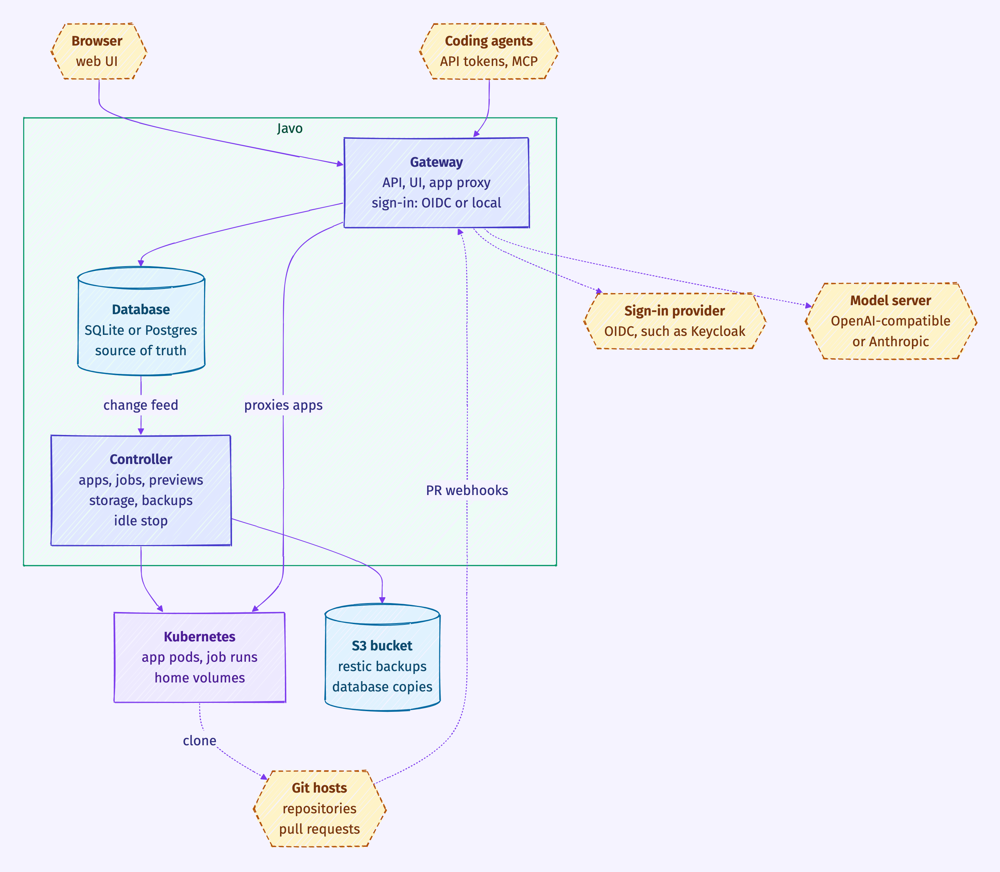
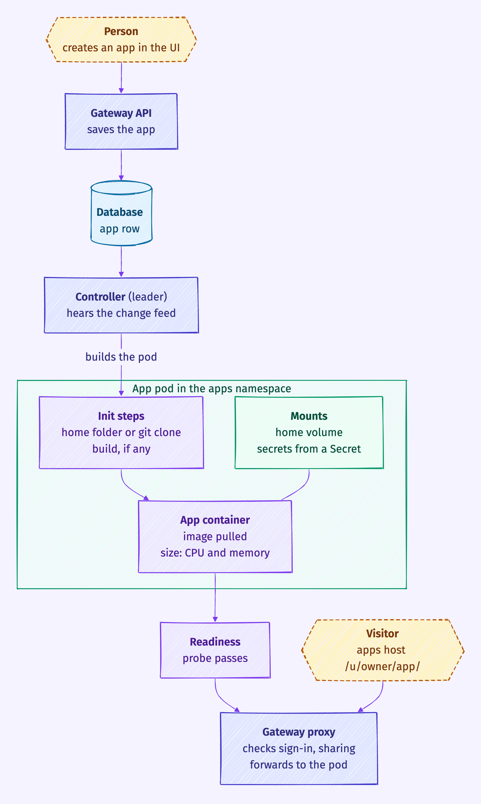

<p align="center">
  <picture>
    <source media="(prefers-color-scheme: dark)" srcset="brand/javo-logo-white.svg">
    
  </picture>
</p>

<p align="center"><b>Notebooks, apps and jobs for data teams, on Kubernetes.</b></p>

<p align="center">
  <a href="https://github.com/nebari-dev/javo/actions/workflows/go.yml"></a>
  <a href="https://github.com/nebari-dev/javo/actions/workflows/ui.yml"></a>
  <a href="https://github.com/nebari-dev/javo/actions/workflows/docs.yml"></a>
  <a href="LICENSE"></a>
  
</p>

Javo runs notebooks, web apps and scheduled jobs for data teams on Kubernetes, from one place.

## Features

- **Apps**: JupyterLab, VS Code, RStudio, marimo, Streamlit, Dash, Panel, Bokeh, Gradio, Voila, FastAPI, static sites, Node and Go back-ends, coding agents, or any container image.
- **Code from anywhere**: run from your home folder or a Git repository, with a preview app for every pull request.
- **Jobs**: run scripts and notebooks on demand or on a schedule, with logs and history.
- **Sharing**: keep an app private, or share it with people, groups, everyone signed in, or the public.
- **Secrets and environment variables**: encrypted at rest and handed to apps and jobs by reference.
- **Sizes**: admin-defined sizes, optionally with GPUs, or custom CPU and memory, controlled by role.
- **Operations**: stop apps when idle, back up to any S3-compatible bucket, admin views of every app and its usage.
- **Sign-in**: local accounts or any OpenID Connect provider, such as Keycloak.

## Quick start

On one machine with Docker Engine and Compose v2:

```sh
cd deploy/compose
docker compose --profile build up -d
docker compose logs -f installer   # ends with the URL
docker compose exec k3s cat /var/lib/javo-secrets/admin.password
```

On an existing Kubernetes cluster, install the Helm chart in `deploy/helm/javo` ([Helm install](site/src/content/docs/getting-started/helm.mdx)).

## Development

Requires Go, Node with pnpm, Docker with Compose v2, kubectl and Helm.

```sh
make test        # unit and integration tests
make up          # local cluster with this checkout, prints the URL
make reload      # rebuild and roll out after a change
make e2e-quick   # core end-to-end tests
make down        # delete the local cluster
```

## Architecture

The gateway serves the UI, the API and the apps; the controller turns database changes into pods.

Javo builds one image, `javo`. Apps and jobs run upstream images as they are published: the templates run the pixi image in a pixi environment of their own (`pod/files/envs`: conda-forge packages pinned by a committed `pixi.lock`), installed into the person's home on the first start and reused after. An app can bring its own environment instead, with a `pixi.toml` and `pixi.lock` at the root of its Git repository or a Nebi environment. RStudio runs the Rocker project's image and static sites run nginx, both unmodified. Samples and other files pods need come from the `javo` image (`pod/files`).



How an app is deployed:



## Documentation

The documentation is the site in `site/` (sources in [site/src/content/docs](site/src/content/docs); `make docs-serve` previews it):

- [Getting started](site/src/content/docs/getting-started): Docker Compose and Helm installs
- [Administer](site/src/content/docs/admin): configuration, [backups](site/src/content/docs/admin/backups.mdx), [secrets and keys](site/src/content/docs/admin/secrets-and-keys.md), [Nebi environments](site/src/content/docs/admin/nebi.md) (optional)
- [Development](site/src/content/docs/contributing/development.md): local clusters, end-to-end tests, single-host deploys
- [Dependencies](DEPENDENCIES.md)
- [Contributing](CONTRIBUTING.md)
- [Security policy](SECURITY.md)
