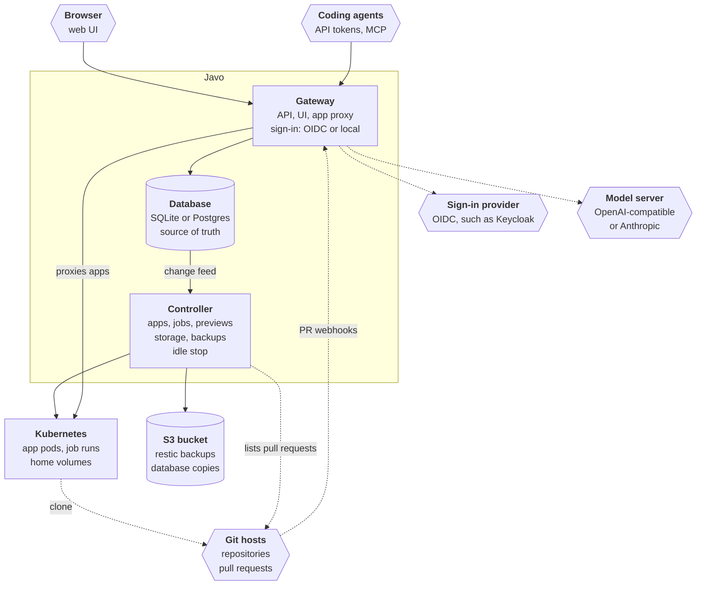
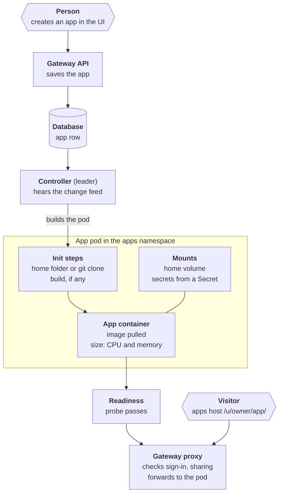

Javo is one Go binary, `javo`, in one image. It runs as two components: the **gateway** and the **controller**. They never talk to each other directly: the **database** sits between them.

## Gateway

The gateway is everything people and agents reach: the web UI, the REST API under `/api/`, the MCP endpoint at `/mcp`, sign-in (local accounts or OpenID Connect) and the app proxy. When a person creates or changes something, the gateway checks it and writes it to the database. It never creates pods itself.

As the app proxy, it checks on every request (and every websocket) that the visitor may open the app, strips Javo's own cookies and tokens, and forwards the request to the app's Service. See [App addresses](/admin/app-addresses/) for how apps get their own origin, and why that matters for sharing.

The gateway answers `/healthz` (the process is alive) and `/readyz` (ready to serve) on its HTTP port.

## Database: the source of truth

Everything Javo knows is in the database: people, accounts, apps, templates, sharing, sessions, tokens, jobs, run history and the audit log. Kubernetes holds only what runs. That is why a backup is the database plus the home folders, and why the controller can rebuild every pod, Service and CronJob from it.

| Engine | How it runs |
|---|---|
| **SQLite** (default) | The gateway and the controller run in one pod and one process (`javo server`); the database is a file on the volume `javo-data`, kept on uninstall. One replica. |
| **Postgres** | A gateway Deployment and a controller Deployment, each with as many replicas as you set. The connection string comes from a Secret. |

## Controller

The controller turns database rows into Kubernetes objects: app pods and Services, job CronJobs and Jobs, pull request previews, home volumes, group folders, backups and idle stops. It hears about changes on a **change feed**: Postgres `LISTEN`/`NOTIFY` (sent inside the writing transaction), or an in-process signal with SQLite. Every 5 minutes it also compares everything, so a missed signal is caught up.

With several controller replicas, one is elected leader (a Kubernetes Lease) and does the work. It also:

- keeps a default-deny NetworkPolicy in every app namespace that lets only gateway pods in, and checks every few hours that the network plugin enforces it;
- lists open pull requests through the GitHub API for previews (a webhook only makes it look sooner);
- runs the nightly backup steps and copies to the S3 bucket.

The controller serves Prometheus metrics on port 8081 and health probes on 8082.

## How an app is deployed

1. A person creates an app in the web UI; the gateway saves the row.
2. The controller hears the change and builds the app's pod in the apps namespace.
3. Init steps run first: attach the home folder, clone the Git repository (with git-sync), build if the template has a build, and install the app's [environment](/using/environments/) into the home on its first start.
4. The app container starts with the size's CPU and memory, the home volume mounted and secrets read from a Kubernetes Secret.
5. Once its readiness probe passes, the gateway proxies visitors to it.

## Namespaces

By default all apps run in one namespace, `javo-apps`. `config.namespaces.mode` can give each person (`per-user`) or each team (`per-team`) a namespace of its own; the controller creates them, labels them for Pod Security "restricted" and never deletes them.

## Images

The project builds one image for the platform, `javo` (plus a small rsync image used only to move homes between storage modes): a distroless image holding the `javo` binary, the web UI, restic for backups, and the files pods need (samples, the start-up script, the template environments). Apps and jobs run upstream images unmodified: the pixi image for most templates, the Rocker project's image for RStudio and nginx for static sites. A list of every pinned image is in `DEPENDENCIES.md` in the repository.
