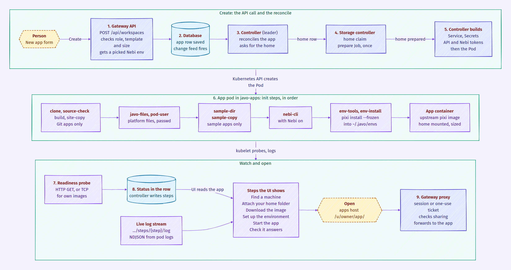

Javo is one Go program, `javo`, shipped in one image. It runs as two parts, the **gateway** and the **controller**, which never call each other: they share a **database**, and the database is the source of truth. The gateway writes what people ask for; the controller reads it and makes Kubernetes run it.

Solid arrows are always there; dotted ones only when that feature is on.

## The pieces

| Piece | Where it runs | What it does |
|---|---|---|
| **Gateway** | namespace `javo-system` | Serves the web UI, the REST API under `/api/`, the MCP endpoint at `/mcp`, sign-in and the app proxy. Checks every request and writes rows to the database. |
| **Controller** | namespace `javo-system` | Turns rows into Kubernetes objects: app pods and Services, job CronJobs and Jobs, home volumes, group folders, preview apps, backups, idle stops, namespaces and their NetworkPolicies. |
| **Database** | a file on the volume `javo-data` (SQLite), or your Postgres | Everything Javo knows: people, apps, templates, sharing, sessions, tokens, jobs, run history, audit log, and the status of each app. |
| **App pods** | namespace `javo-apps` | One bare Pod and one Service per running app, in an upstream image (most templates use the pixi image). |
| **Home volumes** | namespace `javo-apps` | One claim per person, mounted at `/home/user` in their apps and jobs. Their pixi environments live in it too. |
| **Job runs** | namespace `javo-apps` | A CronJob per scheduled job and a Job per run, running `javo runner` in the job's image. |
| **Files pods** | namespace `javo-apps` | A small rclone pod per person that mounts their home read-only so the gateway can list folders for the file picker. Removed after 10 idle minutes. |
| **Helper Jobs** | namespace `javo-apps` | Short Jobs in Javo's own image: ready a new home once, move a home between storage modes, back up or restore a home with restic. |

**One pod or two Deployments.** With SQLite (the default) the gateway and the controller run in one process (`javo server`) in one pod, Deployment `javo`, one replica. With Postgres they are two Deployments, `javo-gateway` and `javo-controller`, each with as many replicas as you set. Either way the Service `javo-gateway` points at the gateway.

**Outside the cluster** (or beside it):

- **Identity provider**: Keycloak or any OpenID Connect provider. Local accounts work without one.
- **Nebi** (optional): where people keep shared pixi environments.
- **S3 bucket** (optional): where backups go, as restic repositories.
- **AI model** (optional): an OpenAI-compatible server or Anthropic, for Ask AI.
- **Git hosts**: apps can run from a repository; GitHub pull requests can get preview apps.

## How a request reaches an app

1. The browser goes to the UI host or the apps host. An Ingress (from the chart) or an HTTPRoute on Envoy Gateway (from the Nebari pack) sends both to the Service `javo-gateway`.
2. The gateway's app proxy finds the app from the address: `/u/<owner>/<app>/` on the apps host, or `<app>.<apps domain>` with subdomains.
3. It checks the visitor's session against the app's sharing on every request, and again every 30 seconds for an open websocket, which it closes once the answer is no. On a separate apps host a signed-in person first passes through a one-use ticket from the UI host, which sets a cookie for that app only. Public apps need no sign-in.
4. It strips Javo's own cookies and tokens, then forwards to the app's Service, `<app>.<namespace>.svc`, on the app's port.

Apps have no login of their own. The NetworkPolicy the controller keeps in every apps namespace lets in only the gateway's pods, so the proxy is the only way in. Every 6 hours (and at start) the controller starts two small probe pods to check that the cluster really enforces it.

A second policy, `limit-egress`, lets app and job pods reach the public internet but, inside the cluster, only DNS, the gateway and their own namespace: not other namespaces' pods, private addresses or the cloud metadata addresses (and, if `networkPolicy.egress.allowCIDRs` is set, nothing not listed). On Kubernetes 1.30+ ValidatingAdmissionPolicies let the controller's account bind roles and change labels only in the namespaces it manages (see [Configuration](/admin/configuration/#security-defaults-to-keep)).

## How an app is created

1. **The form.** The person fills in New app and presses Create. The UI calls `POST /api/workspaces`.
2. **The gateway checks and saves.** It checks the person may create apps and use the template and size, checks the variables and secrets, and, if a Nebi environment was picked, fetches its `pixi.toml` and `pixi.lock` from Nebi as that person. It saves the app row. Nothing in Kubernetes exists yet.
3. **The controller hears it.** The change feed (Postgres `LISTEN`/`NOTIFY`, or an in-process signal with SQLite) wakes the controller. It reads the app, its template and the owner.
4. **The home.** If the owner has no home yet, the controller adds a home row. The storage part of the controller makes the claim and runs a prepare Job once to ready the volume. The app waits until the home is prepared.
5. **The pod is built.** The controller makes the app's Service, the Secrets it needs (the app's secrets, a Git token, an API token, a Nebi token), then the Pod, with the size's CPU and memory and the home mounted.
6. **The init steps run**, in this order, each only when it applies:
   - `clone` and `source-check` (an app that runs from Git; git-sync with depth 1), then `build` and `site-copy` (a template that builds a site);
   - `javo-files` copies the platform's files (start-up script, samples, bundled environments) out of the `javo` image, and `pod-user` writes a passwd entry for the person's uid;
   - `sample-dir` and `sample-copy` copy the template's sample into the home without overwriting edits;
   - `nebi-cli` copies the nebi command in (with Nebi on);
   - `env-tools` and `env-install` run `pixi install --frozen` into `~/.javo/envs/<hash>` in the home. The first start installs; every later start of any app or job with the same files reuses it.
7. **The app starts** in its image (the upstream pixi image for most templates, the Rocker image for RStudio, nginx for static sites), and its readiness probe checks it answers (an HTTP GET, or a TCP connect for an app that brings its own image).
8. **Status.** The controller watches the pod and writes each step into the app row. The UI shows them as **Find a machine, Attach your home folder, Download the image, Set up the environment, Start the app, Check it answers** (and Build the site when there is one). For the home, environment, build and start steps it streams the containers' own output live from `GET /api/workspaces/<name>/steps/<step>/log`, which the gateway reads from the Kubernetes pod logs.
9. **Open.** Once the app is ready, Open takes the person to the app's address and the gateway proxy serves it, as described above.

If a step fails, the UI shows the step, the reason and its log. A missing machine size, a home that is still being moved, or a missing environment stops before the pod is made, with the reason in the status.

## How jobs run

A job is a row like an app. The controller renders each scheduled job into a CronJob, and each run (scheduled or Run now) into a Job, in the owner's namespace. The run's pod gets the same home, platform files and pixi environment install as an app, plus `runner-install`, which copies `javo` in; the main container then runs `javo runner`, which runs the notebook, script or command. The controller records every run and how it ended in the database.

## Where data lives

| Data | Where |
|---|---|
| Everything Javo knows | the database (SQLite file on `javo-data`, or Postgres) |
| People's files and their pixi environments | their home volume in `javo-apps` (or their own namespace) |
| Group folders | one claim per folder |
| What is running | Kubernetes only; the controller can rebuild every pod, Service and CronJob from the database |
| Backups | the claim `javo-backups` and, with a bucket, the S3 bucket |

Namespaces: by default every app runs in `javo-apps`. `config.namespaces.mode` can give each person (`per-user`) or each team (`per-team`) a namespace; the controller creates them, labels them for Pod Security "restricted", adds the NetworkPolicies and never deletes them, since they hold home volumes.

## Sign-in

The gateway signs people in itself: local accounts, or OpenID Connect with the authorization code flow and PKCE at `/auth/oidc/callback`. Groups come from the ID token and map to roles. Sessions live in the database and are rechecked against the provider. Coding agents and scripts use personal API tokens, on the API and on `/mcp`.

**With the Nebari pack**, the pack adds two `NebariApp` objects, one for the UI host and one for the apps host. The nebari-operator turns them into HTTPRoutes on the shared Envoy Gateway with TLS, and provisions Javo's Keycloak client and the Secret holding it. Envoy does not log anyone in; Javo still does that itself, so anonymous visitors can still reach public apps.

## Nebi

With the Nebi integration on, the gateway lists and fetches the person's Nebi environments by trading their ID token for a Nebi token, so it sees what that person sees. An app with Nebi access gets its owner's Nebi token as a file from a Secret the gateway keeps fresh, Nebi's address, and the `nebi` command.

## Backups

- **Database**: every night. With SQLite the server takes a consistent copy (`VACUUM INTO`); with Postgres the CronJob `javo-db-backup` runs `pg_dump`. With a bucket each copy also goes there with restic.
- **Homes and group folders**: with a bucket, a run of the built-in backup job asks for a full backup through the API. The controller then runs one Job per home, as its owner and on the node that holds it, which uploads only what changed. The job's own pod never holds the bucket's key.
- **Restore** is a run of the restore job, the same way.

See [Backups and restore](/admin/backups/).

## AI and Git

- **Ask AI**: the gateway builds a request from what the asking person may see, redacts it, sends it to the configured model and checks the answer against what it sent.
- **Git**: an app pod clones its repository in its init steps. For previews, the controller lists open pull requests through the GitHub API and writes a preview app row for each; a webhook to the gateway only makes it look sooner. Previews run like any app, without the owner's home.

## Images

The project builds one image, `javo`: the binary, the web UI, restic, and the files pods need (samples, the start-up script, the template environments). Apps and jobs run upstream images unchanged: the pixi image for most templates, the Rocker image for RStudio, nginx for static sites, git-sync for clones and rclone for files pods. Every pinned image is listed in `DEPENDENCIES.md` in the repository.
